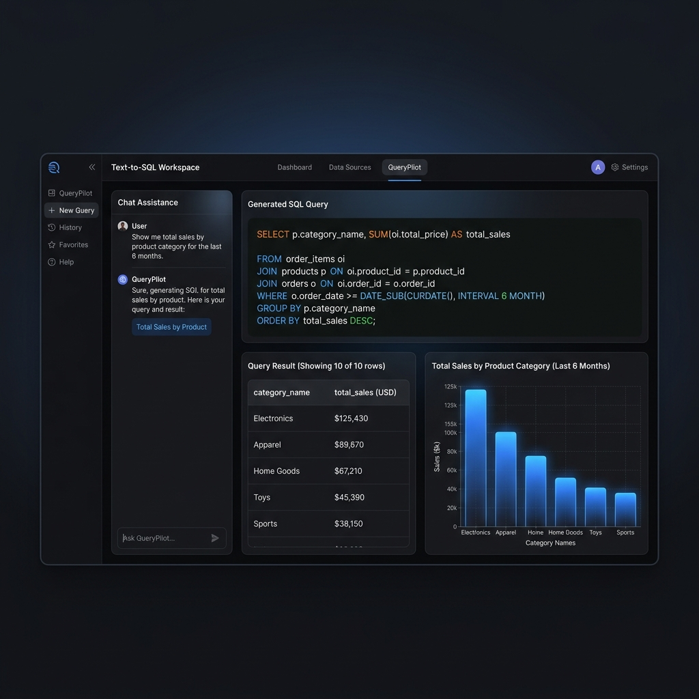
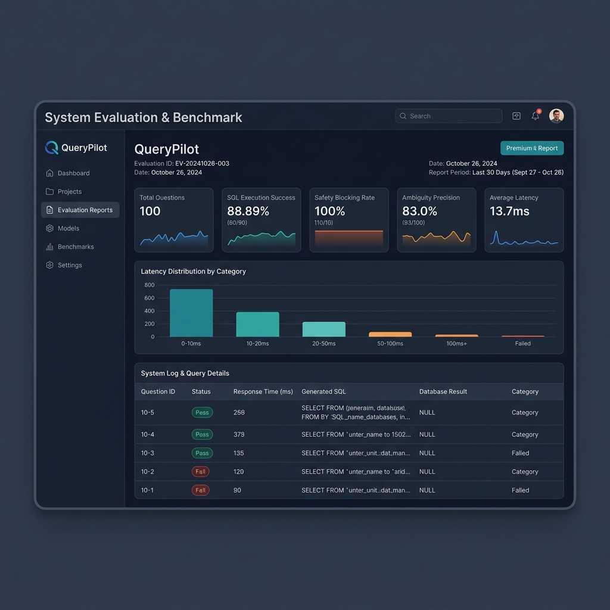
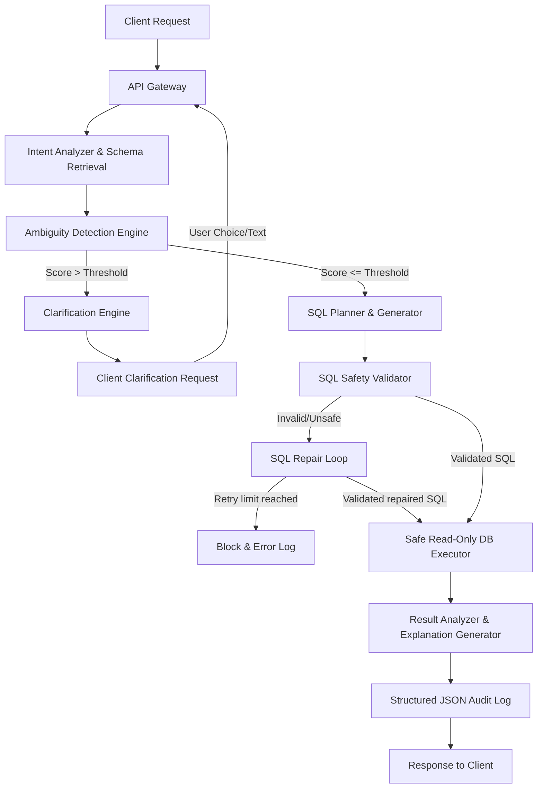

# QueryPilot — Intelligent Text-to-SQL with Ambiguity Resolution

QueryPilot is a state-of-the-art **Intelligent Text-to-SQL platform** designed to safely and precisely translate natural language business questions into optimized, compliant SQL queries. 

Unlike naive translation interfaces, QueryPilot incorporates an **Advanced Clarification Engine** that dynamically calculates ambiguity scores, requests user clarifications when questions are underspecified, validates query ASTs to enforce read-only execution security boundaries, and repairs syntax/schema mismatches automatically.

---

## 📸 Interface Preview

### 1. Disambiguation Workspace
An interactive workspace supporting multi-turn conversation dialogue, real-time ambiguity card resolution, dynamic query metrics, natural-language explanation summaries, and interactive chart visualizations (`recharts`).



### 2. Evaluation & Benchmark Report
Audits platform correctness, security safety blocking rates, and clarification precision against a comprehensive 100-question test suite.



---

## 🛠️ Architecture Pipeline



For a comprehensive specifications breakdown, refer to the [ARCHITECTURE.md](ARCHITECTURE.md) manual.

---

## 🚀 Getting Started

### Run with Docker (recommended for new users)
Docker runs the frontend, backend, PostgreSQL, and Redis in containers. You do
not need to install Python, Node.js, PostgreSQL, or Redis on your computer.

#### Requirements
- [Git](https://git-scm.com/downloads)
- [Docker Desktop](https://www.docker.com/products/docker-desktop/) on Windows
  or Mac. On Linux, install Docker Engine and the Docker Compose plugin.
- Start Docker Desktop (or the Docker service on Linux) before running the
  commands below.

#### Download and start
Open a terminal (PowerShell on Windows) and run:

```powershell
git clone https://github.com/nagarjungowdakn13/Text-to-SQL-with-an-Advanced-Clarification-Engine.git
cd Text-to-SQL-with-an-Advanced-Clarification-Engine
docker compose up --build -d
```

The first build may take several minutes while Docker downloads the base images
and installs application dependencies. Compose creates the application and
execution databases, seeds sample e-commerce data, and starts all four
services. No `.env` file or API key is needed for the default mock LLM.

Check the container status:

```powershell
docker compose ps
```

When the services are up, open:
- **QueryPilot:** [http://localhost:3000](http://localhost:3000)
- **Backend API documentation:** [http://localhost:8000/docs](http://localhost:8000/docs)

If prompted to log in, use one of the sample accounts:
- Admin: `admin@querypilot.com` / `adminpassword`
- Viewer: `viewer@querypilot.com` / `viewerpassword`

#### Common Docker commands
Run these commands from the project folder:

```powershell
# Follow backend logs (Ctrl+C stops following logs, not the containers)
docker compose logs -f backend

# Stop containers and keep database data
docker compose down

# Start again after stopping
docker compose up -d
```

To rebuild after pulling code changes:
```powershell
git pull
docker compose up --build -d
```

To completely reset the local databases and their data:
```powershell
docker compose down -v
docker compose up --build -d
```
Use `down -v` only if you want to erase all data stored in the Docker volumes.

#### Troubleshooting
- **Docker command cannot connect:** Start Docker Desktop, wait until it says
  it is running, then retry.
- **The page or API refuses to connect:** Check `docker compose ps` and inspect
  startup logs with `docker compose logs --tail 100 backend`. Wait for the
  backend to report that database initialization succeeded.
- **Port 3000, 8000, 5432, or 6379 is already in use:** Stop the other
  application using that port, then run `docker compose up -d` again.
- **An existing/older PostgreSQL volume is missing `querypilot_execution`:**
  create that database once, then restart the backend:
  ```powershell
  docker compose exec postgres psql -U postgres -d postgres -c "CREATE DATABASE querypilot_execution;"
  docker compose restart backend
  ```
- **Need live LLM answers:** Configure the provider and API key in a `.env`
  file in the project root (next to `docker-compose.yml`), then run
  `docker compose up --build -d backend`. Keep API keys private; do not commit
  the `.env` file.

### Prerequisites
- Python `3.12+`
- Node.js `20.9+` (npm `9+`; Node.js `22` recommended)

### 1. Backend Server Setup
1. Navigate into the backend directory:
   ```bash
   cd backend
   ```
2. Create and activate a virtual environment (recommended):
   ```bash
   python -m venv venv
   source venv/bin/activate  # On Windows: venv\Scripts\activate
   ```
3. Install dependencies:
   ```bash
   pip install -r requirements.txt
   ```
4. Copy the environment template and configure keys if using live LLM providers (falls back to a mock provider by default):
   ```bash
   cp .env.example .env
   ```
5. Initialize and seed databases:
   ```bash
   python app/setup_sample_db.py
   ```
6. Spin up the FastAPI server:
   ```bash
   uvicorn app.main:app --reload --host 0.0.0.0 --port 8000
   ```

### 2. Frontend Web UI Setup
1. Navigate into the frontend directory:
   ```bash
   cd frontend
   ```
2. Install npm modules:
   ```bash
   npm install
   ```
3. Start the Next.js development server:
   ```bash
   npm run dev
   ```
4. Open your browser and navigate to: `http://localhost:3000`

---

## 🧪 Testing & Benchmark Evaluations

### 1. Pytest Unit Suite
Validate core database handlers, schema pruners, semantics mapping, tokenizers, and security blocking rules:
```bash
# In the workspace root
pytest
```

### 2. Pipeline Evaluations Benchmark
Run the end-to-end 100-question pipeline test suite (including SQL injections, temporal operations, and multi-hop queries):
```bash
# In the workspace root
python evaluate.py
```
*Outputs JSON and HTML dashboards directly inside the `reports/` folder.*

### PostgreSQL permission errors
If query execution reports `permission denied for table ...`, check that
`EXECUTION_DB_READONLY_URL` connects as `querypilot_ro` to the same
`querypilot_execution` database used by `EXECUTION_DB_ADMIN_URL`. The database
setup grants this role access to current tables and tables created later. To
repair grants on an existing database, connect to `querypilot_execution` as
its owner or a PostgreSQL administrator and run:

```sql
GRANT CONNECT ON DATABASE querypilot_execution TO querypilot_ro;
GRANT USAGE ON SCHEMA public TO querypilot_ro;
GRANT SELECT ON ALL TABLES IN SCHEMA public TO querypilot_ro;
ALTER DEFAULT PRIVILEGES IN SCHEMA public
  GRANT SELECT ON TABLES TO querypilot_ro;
```

The default mock LLM also has limited query coverage; configure a supported
LLM provider for natural-language requests beyond the built-in examples.

---

## 🔒 Security Topology (Least Privilege)
QueryPilot segregates database contexts:
- **Application Settings DB (`querypilot_app`)**: Read-write connection holding configurations, credentials, audit trails, and semantic layer registry mappings.
- **Execution Target DB (`querypilot_execution`)**: Managed with two users:
  - **Admin user**: Seeds mock e-commerce tables on bootstrap.
  - **Read-Only user (`querypilot_ro`)**: Used by the query execution engine. SELECT privileges only; INSERT, UPDATE, DELETE, and DDL commands are completely blocked at the engine level.
